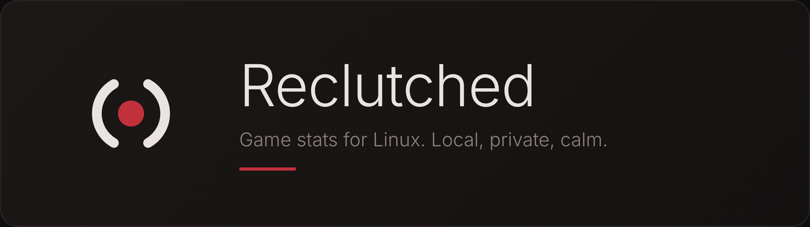

<p align="center">
  
</p>

<p align="center">
  A calm, local stats tracker for Rocket League, built for Linux (works with Proton / Wine).<br>
  Clipping and an in-game overlay are planned.
</p>

---

## What it does

- **Tracks your matches by itself.** Open the app, start Rocket League, and every match is saved when it ends.
- **Match history and details.** Result, score, mode and time, then Overview, Players, Goals and Movement
  (possession, boost habits, speed, touches, goals with your boost at that moment).
- **Everything is a switch.** Each thing we collect can be turned on or off in the settings.
- **Light on disk.** Only averages and small event rows are stored, never the raw 10-per-second data.

## Private by design

- Uses only the game's **official local Stats API**. No injection, no hooks, nothing that touches the game.
- Everything stays on your computer in a local SQLite file. Nothing is uploaded.
- Your settings live in `~/.config/reclutched/settings.json`, your matches in
  `~/.local/share/reclutched/matches.db`.

## Install (Arch Linux)

You need GTK 4 and libadwaita, plus a Rust toolchain.

```bash
sudo pacman -S --needed gtk4 libadwaita base-devel rust git
git clone https://github.com/OlusenBg/Reclutched.git
cd Reclutched
cargo install --path crates/reclutched-ui --locked
cargo install --path crates/reclutched-cli --locked
reclutched-ui
```

The first build takes a few minutes. Cargo installs into `~/.cargo/bin`, so make sure that folder is in your
`PATH` (fish: `fish_add_path ~/.cargo/bin`).

To get it in your app launcher (menu entry and icon), run this once from the repository folder:

```bash
packaging/install-desktop.sh            # undo with: packaging/install-desktop.sh --remove
```

The first launch walks you through a short setup. `reclutched-ui --reset-setup` runs it again.

### Arch package (PKGBUILD)

`packaging/aur/PKGBUILD` builds and installs everything properly (both programs, the launcher entry and the
icon) as a package, so pacman can update or remove it:

```bash
cd packaging/aur
makepkg -si
```

It is not published on the AUR yet.

### Turn on the Stats API

Rocket League only shares your stats when its Stats API is on. In the app, open **Settings** and use
**Find** (or **Choose…**) and **Turn on** under *Rocket League*. It only changes the `PacketSendRate` line of
the game's config file and keeps a backup. Restart the game afterwards.

### Try it without playing

```bash
cargo run -p reclutched-core --example seed_demo -- /tmp/demo.db
reclutched-ui --db /tmp/demo.db
```

## Command line

The same engine is available without a window:

```bash
reclutched track                  # save matches while you play
reclutched history                # list saved matches (--detail, --match ID)
reclutched config list            # show what is collected
reclutched config enable|disable  # switch collectors on or off
reclutched dump                   # print the raw Stats API messages
```

Run only one of the app or `reclutched track` at a time.

## Roadmap

| Stage | |
|---|---|
| 1. Stats tracking | Done |
| 2. Desktop app (UI/UX) | In progress: setup, history, details and settings work; testing and first release next |
| 3. Capturing and clipping | Planned (will use an existing recorder) |
| 4. Overlay | Planned |

## Project layout

| Crate | What it is |
|---|---|
| `reclutched-core` | Stats API parsing, the match tracker, SQLite storage, settings |
| `reclutched-daemon` | Connects to the game and saves matches |
| `reclutched-cli` | The `reclutched` command |
| `reclutched-ui` | The GTK4 / libadwaita app |

The logo and its alternatives are in [`branding/`](branding/).
